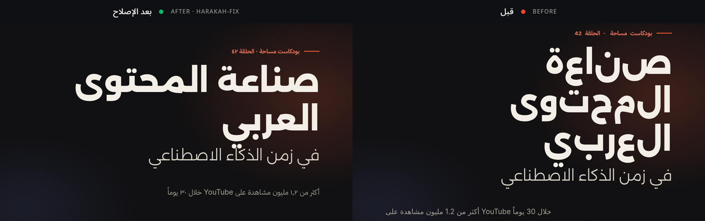
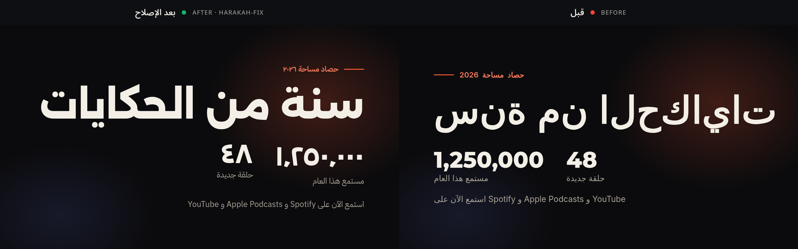

# حركة · harakah-fix: full reference (v0.3)

> The short version is in the [README](../README.md). This page documents every command, option, rule and limitation.

**Detect and fix broken Arabic in motion graphics**: HTML (HyperFrames, GSAP/SplitText, plain HTML/CSS) and **Remotion** (`.tsx/.jsx` codemod, verified with real Remotion renders).
**كشف وإصلاح النص العربي في الموشن جرافيك** قبل الرندر: حروف متقطعة، اتجاه خاطئ، أرقام مخلوطة، خطوط بلا عربي، وتراخيص الخطوط.

The headline bug: per-letter animation (GSAP `SplitText({type:"chars"})`, `[...str]`, `split('')`) puts every Arabic
letter in its own `inline-block` box, so Chrome draws each letter in its **isolated** form and the word falls apart.
The fix keeps your per-letter animation and pads each letter with U+200D ZERO WIDTH JOINER so it renders in the
right contextual form, with لا kept as one ligature. On the demo title the before render has 8/11/10 ink pieces per word; after the fix it has 5/5/4, which matches plain running text.



**Remotion** (real `@remotion/renderer` output, codemod applied to an AI-style "year in review" composition):



> HyperFrames' own `hyperframes check` passes the broken demo with **0 errors/0 warnings**: its linter does not see this bug at all.

## Install

Requirements: Node ≥ 22.12, Google Chrome/Chromium (auto-detected on Linux, macOS and Windows, plus Playwright's Chromium; override with `HARAKAH_CHROME=/path/to/chrome`), `ffmpeg` for PNG composites and MP4.

`harakah-fix doctor [--json]` checks the machine: Node version, the bundled fonts, the temp folder, Chrome (found, starts, and joins Arabic: «سلام عليكم» rendered with a bundled font must have fewer ink pieces than the same letters split), the headless mode Remotion will get, ffmpeg, and, in a Remotion project, `@remotion/bundler` and `@remotion/renderer`. Each problem prints the fix. Exit 1 when something `check`/`fix`/renders need is missing; ffmpeg and Remotion packages are warnings.

```bash
npm install -D harakah-fixer        # → npx harakah-fix …

# from a checkout
npm install
npm run build          # → dist/
npm link               # optional: puts `harakah-fix` on PATH (or use `node dist/cli.js`)
```

## CLI

```bash
harakah-fix check  composition.html                 # bilingual report (exit code 1 if errors)
harakah-fix check  composition.html --json          # JSON report
harakah-fix check  composition.html --lang ar       # Arabic-only report (en | ar | both)
harakah-fix fix    composition.html -o out/fixed.html --report out/report.json
harakah-fix gate   ./my-project                      # exit 1 if Arabic would render broken, 2 if it couldn't be checked (prerender / CI / agents)
harakah-fix compare composition.html -o out/cmp     # before.png, after.png, compare.png (+ join audit)
harakah-fix compare composition.html -o out/cmp --video --tail 1.5 --time 5 --panel-width 960   # + compare.mp4 (HyperFrames engine, ~15 s)
harakah-fix audit   composition.html --width 1920 --height 1080   # runtime layout audit: visual order of Arabic at sampled frames (HZ24)
harakah-fix gate    ./my-project --layout                # gate + runtime layout audit (HTML files, or every Remotion composition)
harakah-fix audit   ./my-remotion-project --composition Title --props props.json   # layout audit of Remotion compositions (bundle + seek)
harakah-fix audit   composition.html --fix -o out/fixed.html # auto-fix + the HZ24 rules verified in Chrome (`--write` in place)

# Remotion / React (.tsx/.jsx files or a whole project folder: scans src/)
harakah-fix check   my-remotion-app                          # report (exit 1 on errors)
harakah-fix check   ./examples                               # any folder: .tsx/.jsx code + every HTML file with Arabic (HyperFrames/GSAP) + .astro/.vue/.svelte templates
harakah-fix check   src/components/Hero.astro                # one template (original line numbers)
harakah-fix fix     src/components/Hero.astro                # template: prints a reviewable unified patch (nothing written)
harakah-fix fix     src --patch harakah-templates.patch      # every template in a folder → one patch file; review, then `git apply`
harakah-fix fix     src/components/Hero.astro --write        # apply the template patch in place
harakah-fix fix     my-remotion-app --dry-run                # colored unified diff, writes nothing
harakah-fix fix     src/Title.tsx --dry-run --json           # + "changes": [{ file, text, create }] = every file --write would write (editors apply these)
harakah-fix fix     my-remotion-app --write                  # rewrite in place (+ vendors src/harakah-arabic.tsx)
harakah-fix fix     my-remotion-app -o fixed-app             # fixed copy of the project (node_modules symlinked)
harakah-fix fix     src/Title.tsx -o out/Title.tsx --diff    # single file
harakah-fix compare my-remotion-app --composition Intro --video -o out/cmp   # real renders: PNG + side-by-side MP4 + join verdict
harakah-fix compare Title.tsx -o out/cmp --frames 120        # lone file: scaffolded Remotion project
```

Options (shared by `check`, `fix`, and `compare`):

| Option | Default | Meaning |
|---|---|---|
| `--digits eastern\|western\|keep` | **eastern** | Digit policy. `eastern` turns text digits into ١٢٣ (and `.` → `٫`, `,` → `٬`, `%` → `٪` between/after digits). Latin runs such as `iPhone 17` are left alone. `Intl`/`toLocaleString('ar-…')` calls get `-u-nu-arab` (or `-u-nu-latn` with `western`). `keep` only reports mixing. Same toggle in the web UI. |
| `--split zwj\|word` | zwj | Per-letter split repair. `zwj` keeps the same letter boxes, so timelines and staggers still work. `word` merges the boxes into one box per word. |
| `--font plex\|alexandria\|readex\|cairo\|tajawal\|naskh` | plex | OFL Arabic fallback added after Latin-only fonts and used for injected `@font-face` |
| `--font-src file\|data\|google\|none` | file | `file` copies the bundled TTF + OFL license to `<outdir>/fonts/`, `data` inlines base64, `google` adds a Google Fonts `<link>` |
| `--replace-proprietary` | off | Swap Thmanyah or commercial Arabic fonts for the OFL font (for hosted/cloud renders) |
| `--no-bidi` | – | Don't wrap Latin runs in `<bdi>` |
| `--shim auto\|always\|never` | auto | Inject the runtime ZWJ shim (auto = when runtime char splitting is detected) |
| `--only HZ01,HZ07` / `--disable HZ13` | – | Run or skip specific rules |
| `--engine auto\|hyperframes\|chrome` | auto | `compare --video` for HTML: HyperFrames compositions render through `npx hyperframes render` (~15 s for two 12.5 s clips; local assets incl. `../node_modules` are copied into a temp project). Other HTML, or any HyperFrames failure, falls back to frame-by-frame Chrome capture (minutes). |

Remotion-only options: `--font auto|plex|alexandria` (auto: display families → Alexandria, text families → IBM Plex Sans Arabic), `--props <json|file>` (render-time input props, as passed to `remotion render --props`; Arabic top-level keys mark the receiving composition, or every composition if none matches `--composition`), `--assume-arabic` (treat every component as Arabic), `--prettier auto|always|never` (auto = format only files that were already prettier-clean), `--helper auto|vendor|package`, and for `compare`: `--composition`, `--frame`, `--component`, `--frames`, `--width/--height/--fps`.

## Remotion

AI assistants write Remotion titles the same way every time: `text.split("").map(...)` with `display: inline-block` + spring, `letterSpacing`, a Latin `@remotion/google-fonts` font, no `dir`, `toLocaleString("en-US")`. In Arabic that gives reversed, disconnected letters (an LTR flex row of isolated forms), tofu or fallback fonts, Western digits and scrambled `Spotify`/`!` placement. harakah-fix rewrites the code with an AST codemod (ts-morph), so the fix lives in your source, not in a runtime patch.

### What the codemod changes (auto-fix)

| Pattern | Rewrite |
|---|---|
| `x.split("")`, `Array.from(x)`, `[...x]` on strings (by type, literal, or an untyped text-like variable consumed by `.map`) | `/* harakah: was x.split("") */ splitArabic(x)`: ZWJ-padded grapheme tokens, لا kept, tashkeel attached, spaces kept as `" "`. `--split word` → `splitArabic(x, "word")`. |
| `letterSpacing` (static or interpolated) | `0 /* harakah: letterSpacing removed for Arabic (was …) */` |
| component root without `dir` | `dir="rtl" lang="ar"` on the returned root element(s) (also inside fragments) |
| `direction: "ltr"`, `textAlign: "left"`, `textTransform`, `fontVariant: small-caps`, `wordBreak: "break-all"` | `"rtl"`, `"start"`, `"none"`, `"normal"`, `"normal"` |
| `lineHeight` < 1.6 on text with tashkeel | `1.8` |
| Latin-only `@remotion/google-fonts/<Family>` | `Alexandria` (display families: Bebas Neue, Montserrat, Anton, Oswald, Poppins…) or `IBMPlexSansArabic` (text families: Inter, Roboto…); weights clamped (Plex ≤ 700), `subsets: ["arabic", "latin"]`, explicit weights when `loadFont()` had no options (avoids ~36 font requests) |
| string `fontFamily` stacks with no Arabic font | `"…, 'IBM Plex Sans Arabic', sans-serif"` + a module-level `loadFont` for it |
| Arabic OFL family referenced by name but never loaded (e.g. `'Noto Naskh Arabic'`) | adds the matching `@remotion/google-fonts` loader |
| digits (`--digits eastern` default) | Arabic JSX text and strings → ١٢٣ (escapes, entities and Latin runs like `iPhone 17` untouched); `{count}` / `${n}` in Arabic templates and `n.toLocaleString("en-US")` → `formatDigits(n)` (١٬٢٥٠٬٠٠٠); `toLocaleString("ar-SA")` → `"ar-SA-u-nu-arab"`. Eastern always uses the Arabic separators ٬ (U+066C) and ٫ (U+066B), including Eastern digits typed with Latin `,` `.`. When an Alexandria loader styles grouped digits, it is wrapped in `withArabicSeparators()`, because Alexandria draws ٬ ٫ with its Latin comma glyph. `western` does the reverse, `keep` leaves digits. |
| Latin runs inside Arabic | JSX text → `<bdi>Spotify</bdi>`; string/template literals in JSX → `\u2068Spotify\u2069` (FSI/PDI) |
| styled-components / emotion / `css` templates, CSS modules imported by Arabic components, Tailwind classes | `letter-spacing: 0`, `text-transform: none`, `text-align: start`, `word-break: normal`; `tracking-*` → `tracking-normal`, `uppercase` → `normal-case`, `text-left` → `text-start`, `break-all` → `break-normal` |
| Tailwind classes inside class expressions: `className={cn("…", on && "…", { "…": c, uppercase: big })}`, `clsx`/`classnames`/`cx`/`twMerge`/`twJoin`/`tw`, template literals `` `px-4 ${x} tracking-wide` ``, ternaries, arrays, `[…].join(" ")` | the same token rewrites, one edit per literal token at its exact position (an identifier key becomes a string key: `{ "normal-case": big }`). Tokens glued to `${}` (`` `tracking-${size}` ``), variables and `cva()` are left alone. The author's `rtl:` variant is found anywhere in the expression |

**Props-aware.** A component with no Arabic in its own file is still fixed when Arabic reaches it through props. Harakah follows:
- `<Composition component={X} defaultProps={{ title: "…" }} />` and `<Still>`, including a referenced object or a zod `schema` with `.default("…")`
- `X.defaultProps = {…}`
- JSX usage anywhere in the project: `<X title="…" />`, `<X title={ARABIC_CONST} />`, `<X>…</X>`, `<X {...obj} />`
- pass-through to child components in other files: `<Kicker label={kicker} />`, `<Inner {...props} />`

It resolves imports, renamed destructuring, `props.x`, and `memo`/`forwardRef`. `check` and `fix` print the chain, for example `Kicker: label ← PropsTitle (title, kicker) → <Kicker>`. Props that only receive numbers or Latin text don't count, and `<Composition>` registrations in `Root.tsx` are not treated as rendered Arabic. Render-time props are followed with `--props props.json`; `--assume-arabic` is now rarely needed (text from `calculateMetadata` or fetched data).

**`--wrap-words`** (optional): `splitArabic(x).map(cb)` → `mapArabicWords(splitArabic(x), cb)`. This groups the per-letter boxes into nowrap word boxes, so a wrapping title never breaks mid-word. The animation and stagger are unchanged. Without the flag this case is report-only. A Chrome layout test confirms that plain per-letter boxes split words across lines and the word boxes never do.

Every change carries a short `harakah:` comment. The transform runs to a fixpoint and is **idempotent** (running it again changes nothing; tested on every fixture). Files without Arabic, and correct Arabic code, are left byte-for-byte alone. Helpers are imported from `@harakah/remotion-arabic` when it is a dependency, otherwise the single-file helper is vendored as `src/harakah-arabic.tsx` (or next to a lone file) and imported relatively. Prettier runs only on files that were already prettier-formatted (or with `--prettier always`).

### Report-only (with a suggested patch)

- `lineHeight` too tight for tashkeel **inside a fixed-height `overflow: hidden` box** (raising it would clip more): suggests `lineHeight: 1.8` + `minHeight`.
- Per-letter boxes inside a **wrapping** (non-flex, no `nowrap`) container: lines can break mid-word. Suggests word boxes, `<ArabicText>` or `--split word`. **`--wrap-words` fixes it automatically.**
- Untyped values that might be text but aren't clearly consumed as text, e.g. `[...x]` where `x` is `any`: suggests `splitArabic(x)`.
- `….reverse().join()` string reversal, canvas `fillText`/`measureText`, SVG `<tspan>` per letter, root elements that spread props (`{...props}`) without `dir`, `fontStyle: italic`, fonts referenced by name with no known loader.

### Translations (i18n follow)

In project mode, Arabic that arrives through translation keys counts as Arabic text:
- next-intl `const t = useTranslations("Hero"); t("title")` with `messages/ar.json`
- react-i18next/i18next `const { t } = useTranslation("common"); t("cta")` or `t("common:cta")` with `public/locales/ar/common.json`
- react-intl `intl.formatMessage({ id: "promo" })`
- dictionary objects: `const dict = await getDictionary(lang); dict.products.cart` (the Next.js docs pattern), a custom `const { t } = useTranslation(); t.hero.title`, `t["nav"]["home"]`, `t.items[0]`. The root must come from a `use…/get…/load…` + Translation/Dictionary/Messages/Locale/Lang/I18n/Strings/Copy/Content call, or be a prop named `dict`, `dictionary`, `messages`, `t`… (a sub-dictionary prop resolves by key suffix)
- section + key helpers: `t("nav", "home")` → `nav.home`
- dictionary arrays: `t.hero.stats.map((stat) => stat.label)` and `{tag}` from `t.tags.map((tag) => …)`. A field that is Latin in every item (`stat.value`: "3+", "AI + Web") stays Latin.

Locale files can be JSON or TS/JS modules (`locales/ar.ts` exporting an object literal, `as const`/`satisfies` included). Inline locale maps in app code (`const translations = { ar: { nav: { … } }, en: { … } }`) are indexed too.

Only Arabic-script locale files (`ar`, `fa`, `ur`, `ps`, `ckb` … in a `messages/`, `locales/`, `i18n/`, `lang/`, `translations/` folder, or `ar.json` at the root) are read. They are never edited. Props are followed too: `<Title text={t("title")} />` makes `Title` (in another file) an Arabic component. A key that stays Latin in the Arabic locale (`"brand": "Acme"`) is treated as Latin.

**Multilingual apps** (an `en.json` or `locales/en/` next to the Arabic one): a component whose Arabic comes only from translations also renders the other locales, so hardcoding `dir="rtl"` or `letterSpacing: 0` would break them.
- **Automatic** (correct for every locale): `splitArabic` (a no-op for Latin), the Arabic font fallback, and `text-align: start`.
- **Report-only with a locale-aware patch:** direction ("set it once at the root: `<html lang={locale} dir={locale === "ar" ? "rtl" : "ltr"}>`"), tracking, case, line height and word-break (`letterSpacing: isRtl ? 0 : 4`, or Tailwind `rtl:tracking-normal`).
- **Digits** are locale-aware too: `{year}` in a translated element is reported ("formatDigits(n) only when isRtl"), not forced to ١٢٣ in every locale.
- A layout that already sets a locale-driven `<html dir={…}>` (or `documentElement.dir = i18n.dir()`, also through an alias such as `const html = document.documentElement; html.setAttribute("dir", …)`) counts as app-level direction, so no direction finding at all.
- **Locale branches count as per-locale content**, with or without locale files: `{lang === "ar" ? <span>قهوتنا</span> : <span>Our Coffee</span>}`, `isRtl && …`, `{ ar: "…", en: "…" }[lang]` or `content[lang].title` with a module-level `{ ar: {…}, en: {…} }`.
- The decision is made **per element**: an element showing literal Arabic is fixed automatically, the translated element next to it is reported. An edit inside an Arabic string literal (the ar branch of a ternary, the `ar` block of a locale map) only changes Arabic text, so it is applied.

### Suppression comments

When a finding is intentional (a "broken" demo, a deliberate LTR label), silence it in the source. Add rule codes to silence only those rules.

```tsx
<span style={{ letterSpacing: 4 }}>{label}</span> {/* harakah-ignore */}
{/* harakah-ignore-next-line HZ07 */}
<h2 style={{ letterSpacing: 6, textTransform: "uppercase" }}>عنوان</h2>   // HZ08 still reported
// harakah-disable-file            ← the whole file
// harakah-disable-file HZ12       ← one rule for the whole file
```

```html
<!-- harakah-ignore -->            <!-- the next element and everything inside it -->
<section class="broken-demo">…</section>
<!-- harakah-ignore HZ07 HZ08 -->
<h2 class="kicker">…</h2>
<!-- harakah-disable-file HZ12 --> <!-- also works as /* … */ in <style> or // in <script> -->
```

In `.tsx`/`.jsx`, `harakah-ignore` covers its own line and `harakah-ignore-next-line` the next line. In HTML both cover the next element's subtree, because line numbers shift after a fix. Suppressed elements are also left out of aggregated rules (digits, bidi isolation), so `fix` leaves an ignored demo byte-for-byte alone.

### Persian, Urdu and other Arabic-script languages

The script language is detected from signature letters (پ چ ژ گ ک ی for Persian; ٹ ڈ ڑ ں ے ہ for Urdu). `dir`/`lang` fixes write `lang="fa"` or `lang="ur"`, and the Eastern digit policy produces ۰–۹ for those languages (٠–٩ for Arabic). An existing `lang="fa"`, `ur`, `ps`, `ckb`, `ku`, `sd`, `ug` and so on counts as correct and is never "fixed" to `ar`.

### What is deliberately *not* flagged (learned from real projects)

- `Array.from({ length: n })`, `Array.from(el.children)`, `querySelectorAll`, number splits (`String(n).split("")`, `toFixed`, `padStart`) and digit-only strings: not text.
- A split that is joined straight back (`text.split("").slice(0, n).join("")`, the classic typewriter).
- Per-letter **plain inline** spans that only change `opacity`/`color`/`textShadow`/`background`, inside a plain (non-flex, non-grid) block. Chrome shapes across inline boundaries, so they stay joined (measured). `display: inline-block`, `transform` or a flex/grid parent still break joining and are fixed.
- `dir` is never added to a custom component (`<Scene>`, `<Fa>`): that would be a type error. It goes on the outermost DOM element (`div`, `motion.div`, `AbsoluteFill`), or the finding is report-only. Text passed as `children` to a wrapper component belongs to that wrapper.
- An app whose shell is RTL (`app/layout.tsx` or `pages/_document.tsx` with `<html dir="rtl">`, `index.html`, or `document.documentElement.dir = "rtl"`) gets no per-component `dir`.
- Fonts loaded with `new FontFace(…)`, `@font-face` in any project CSS, `@remotion/google-fonts/*` or a Google Fonts link count as loaded. A custom family the project loads itself (`@font-face { font-family: 'Saudi' }`) isn't reported as "no Arabic font": its coverage can't be known without reading the font file.
- **Web apps** (a `package.json` without `remotion`): no `@remotion/google-fonts` loader is ever inserted. A stack without an Arabic font is reported with a web suggestion (Google Fonts, `@fontsource/ibm-plex-sans-arabic`).
- Tailwind `tracking-*`/`uppercase`/`break-all` on an element whose children are only Latin (`<a className="break-all">name@example.com</a>`), same rule as inline styles.
- **Template placeholders** in HTML (starter kits, Jinja/Liquid/Handlebars/EJS): `<html lang="{{LANG|ar}}" dir="{{DIR|rtl}}">` uses the written default (`dir="{{ dir }}"` with no default counts as `auto`). In text, `{{BADGE_TEXT|متوفر الآن}}` is analyzed as its default; the tag name is never a "Latin run" and fixes never edit inside a tag (`{{X|شحن 2 أيام}}` → `{{X|شحن ٢ أيام}}`).
- Style rules on elements whose text is static Latin (`WEEKLY ROUNDUP`, or a `const` bound to a Latin string) are left alone, and so are Latin names with non-breaking hyphens (`GPT‑5`).
- `lineHeight`/`line-height` with an occasional diacritic (a shadda, tanween or Persian ezafe kasra) at normal leading (≥ 1.3), or on a single line. Fully vocalized text still needs about 1.8.
- Visually hidden text (`.sr-only`, `.visually-hidden`, `clip: rect(0 0 0 0)`, `clip-path: inset(50%)`), such as an `<h1 class="sr-only">` inside an LTR wordmark.
- A split in the non-Arabic branch of an Arabic test: `/[\u0600-\u06FF]/.test(name) ? name.split(/(\s+)/) : [...name]` (also `isArabic(x)`, `locale === "ar"`, negated tests, if/else). Array copies (`const next = [...prev]; next.push(x)`) aren't "possible text splits".
- Inlined minified third-party bundles (MapLibre, three.js…) with no Arabic in them aren't scanned for split/prepend idioms.
- `fontFamily: "inherit"` / `var(--font-x)` take the family from elsewhere (no HZ09). A Google font pulled in with `@import url(fonts.googleapis.com…)` inside `<style>` counts as loaded, and the `font` shorthand (`font: 700 64px/1.4 'Noto Naskh Arabic'`) is parsed for its family.
- App Router segment layouts count as the app shell: next-intl's `app/[locale]/layout.tsx` with `<html lang={locale} dir={dir}>` is app-level direction.
- Thmanyah: one finding per font family. A font file inside the project is a **warning** (local use is allowed; don't commit or share it). Loading it from a URL, CDN or `data:` stays an **error**.

### Verified with real renders

`harakah-fix compare` bundles the original project and a codemod-fixed copy with `@remotion/bundler`, renders stills (and MP4s with `--video`) with `@remotion/renderer` + Chrome, and builds a labelled side-by-side. The join verdict compares the fixed render with a **running-text reference**: the same fixed bundle rendered with `REMOTION_HARAKAH_REFERENCE=1`, which makes `splitArabic()` return the whole string as one token. "Joined" = ink pieces within ±6 % and ink width within 4 % of the reference and < 20 % pixel difference. On the fixtures the fixed renders differ from the reference by 0–1 % of ink pixels; the originals differ by ~100 %.

A lone `.tsx` outside a Remotion project is wrapped in a scaffolded project (exported components registered at 1280×720@30, `--frames` long) using the Remotion install in `fixtures/remotion/node_modules`, or `HARAKAH_REMOTION_MODULES=/path/to/node_modules`.

### `@harakah/remotion-arabic` (drop-in component + helpers)

`packages/remotion-arabic/src/index.tsx` is self-contained (react + remotion only) and documented in English and Arabic:

```tsx
import { ArabicText, splitArabic, formatDigits, isolateLatin, withArabicSeparators } from "@harakah/remotion-arabic"; // or ./harakah-arabic

<ArabicText as="h1" text="قصص تستحق أن تُروى" preset="rise" stagger={2} style={{ fontFamily, fontSize: 104 }} />
<ArabicText by="word" text={`أكثر من ${formatDigits(250000)} مستمع`} preset="fade" delay={30} />

splitArabic("لا إله")        // ["لا", " ", "إ", "ل\u200D", "\u200Dه"]
splitArabic("سنة من", "word") // ["سنة", " ", "من"]
formatDigits(1250000)         // "١٬٢٥٠٬٠٠٠" (always U+066C / U+066B, independent of the renderer's ICU data)
const { fontFamily } = withArabicSeparators(loadFont("normal", { weights: ["800"], subsets: ["arabic"] })); // Alexandria: draw ٬ ٫ ٪ from IBM Plex Sans Arabic
//   formatDigits("الحلقة 48 على iPhone 17") → "الحلقة ٤٨ على iPhone 17"
isolateLatin("على Spotify")   // "على \u2068Spotify\u2069"
```

`<ArabicText>` props: `text`, `by` (`letter` | `word`), `delay`, `stagger`, `duration`, `preset` (`rise` | `fade` | `blur` | `scale`), `animate(progress, index, token)` for custom styles, `springy`, `digits`, `style`, `tokenStyle`, `className`, `as`. It renders `dir="rtl" lang="ar"`, keeps each word in a `nowrap` box (no mid-word line breaks), and its output is pixel-identical in shape to running text (render-tested).

## Claude Code / AI agents · للوكلاء

Claude Code (or any MCP client) can check Arabic compositions as soon as it writes them, and it **can't render broken Arabic**:

```bash
npm run build
claude plugin marketplace add "$PWD" && claude plugin install harakah@harakah   # plugin: skill + hooks + MCP + harakah-fix on PATH
# or per project:
node integrations/claude-code/install.mjs /path/to/project   # skill + hooks + .mcp.json (idempotent merge)
# or just the MCP server:
claude mcp add harakah -- node "$PWD/dist/mcp.js"
```

- **MCP tools** (`harakah-mcp`, stdio):
  - `harakah_check`: takes a path or inline code
  - `harakah_fix`: inline code returns fixed code plus notes; a path is previewed, or written with `write: true`
  - `harakah_gate`: before rendering; `ok: false` means don't render
  - `harakah_compare`: real before/after render, returns a PNG and the join verdict
- **Hooks** (`harakah-hook`):
  - PostToolUse on Write/Edit checks each edited Arabic composition and returns the problems to Claude.
  - PreToolUse on Bash denies `remotion render|still`, `hyperframes render` and `npm run render` while the gate fails.
- **Skill** (`.claude/skills/harakah/SKILL.md`): the check → fix → gate → compare workflow, plus the rules for writing Arabic compositions correctly from the start. All copies of the skill are generated from `skill-src/` (`npm run build:skills`); `test/consistency.test.ts` fails if one was edited by hand.
- **Inside Remotion:** `Config.overrideWebpackConfig(withHarakah())` in `remotion.config.ts` (from `harakah-fixer/remotion`). `remotion render`/`still` then fails while the Arabic is broken, and Studio shows a live Harakah panel with the issues ([`integrations/remotion/`](../integrations/remotion/README.md)). With `layout: true` the panel adds **Layout over time (HZ24)**: findings per composition (the one open in Studio first), the flagged frame numbers, and the verified suggestion (`dir="rtl"` on the `<div>` holding the text). `gate --layout --json` carries the same data in `layout`.
- **VS Code:** `integrations/vscode` shows diagnostics from `harakah-fix check --json` on open and save, with quick fixes: HTML `-o` in place, `.tsx` codemod `--write`. Templates get **Preview fix**: the patch as an original ↔ fixed diff with the findings count, then **Apply** as one undoable editor edit (also `harakah.previewFix` / `harakah.applyFix` in the palette). Remotion `.tsx`/`.jsx` get the same: `fix --dry-run --json` lists every file the codemod would write (the component, a vendored `harakah-arabic.tsx`, CSS), shown in the multi-file diff editor and applied as one undoable workspace edit. HTML still fixes on disk, because its fix copies font files. It works in a stock VS Code where `.astro`/`.vue`/`.svelte` open as plaintext (activation on `workspaceContains` + plaintext, quick fixes matched by file pattern). `npm run test:vscode` runs it in a real, pinned VS Code (CI job `vscode (real editor)`). Packaged locally as `out/harakah-vscode-0.2.0.vsix`, not published.
- **Without an agent:** `harakah-fix gate .` as an npm `prerender` script, in CI, or as a git pre-commit hook (`integrations/hyperframes/`).

Details: [`integrations/claude-code/README.md`](../integrations/claude-code/README.md) and [`integrations/hyperframes/README.md`](../integrations/hyperframes/README.md).

## GitHub Actions

`harakah-fix gate <target> --github` prints one workflow command per problem: `::error file=…,line=…,title=HZ02 …::message` for what blocks (errors, and warnings with `--strict`), `::warning` for other warnings, and `::error` for each check that couldn't run. Notes aren't annotated. Errors come first, because GitHub shows only the first ten annotations of each level per step. Paths are relative to the working directory. Remotion layout findings belong to a composition, not a file, so they're annotated on the project folder with the composition id in the message. With `GITHUB_STEP_SUMMARY` set (always, in a workflow), it also appends a job summary: the verdict, a table of every blocking problem (file:line, rule, auto/manual), what couldn't be checked, and the fix command. With `--json`, stdout stays JSON and only the summary is written. Exit codes are those of `gate` (0/1/2).

The workflow to copy is `integrations/github-actions/harakah.yml` (shipped in the npm package): `npx -y -p harakah-fixer@0.4 harakah-fix gate . --github` on `pull_request` and pushes to `main`, plus commented-out steps for `--layout` (Chrome is installed on GitHub's Ubuntu runners) and for uploading `compare` renders as evidence when it fails.

## Web UI (local; public mode for hosting)

```bash
harakah-fix serve  # → http://127.0.0.1:4747  (localhost only; -p/--port, --host)
npm run serve      # same, from a checkout
```

- `http://127.0.0.1:4747/` is **the tool**.
- `http://127.0.0.1:4747/landing` is **the landing page**.
- The landing page is built from `site-src/` (`node site-src/build.mjs` writes `web/landing.html`; `scripts/build-static.mjs` turns it into the static site). The tool page is `web/index.html`.
- Both are Arabic-first with an **ع / EN** toggle and a **◐ ☀ ☾** theme toggle. Both default to Arabic and the system theme, and both choices are remembered in localStorage and shared between the pages.

**What the tool does:**
- You can paste or drag in HTML **or a Remotion `.tsx/.jsx` component**, or pick a fixture example from the HTML or Remotion group.
- **For TSX,** the page runs the codemod and shows:
  - a colored unified diff
  - the fixed code (copy/download)
  - a download link for `harakah-arabic.tsx`
  - "Render before/after", which does a real Remotion render with the join verdict (about 15–25 s)
- **For HTML,** it shows:
  - the bilingual issue list
  - the fixed HTML (copy/download)
  - before/after headless-Chrome screenshots with the join audit
  - with **"With a compare video"** ticked, an inline MP4 (side by side, up to 12 s; HyperFrames when available, otherwise headless Chrome; Remotion in project mode) with a download link. API: `POST /api/compare` with `video: true` returns `video: "/api/video/<id>"` (Range-capable, kept 30 minutes).
- **Whole projects:** drop a Remotion project folder or `.zip` (or use the folder/zip buttons). The server runs the same project pipeline as the CLI, following props across files and shared theme/style modules, and offers a fixed `.zip` (zip uploads keep every file) and a `.patch` (`git apply`). Uploads live in the OS temp dir for 30 minutes; limits: 3000 files, 8 MB per file, 60 MB total.
- **Render props in project mode:** pick a composition and render props, the same contract as `--props`/`--composition`. Props can be any JSON file in the upload (files with Arabic are listed first, and the page suggests one when it finds it) or inline JSON. "Re-check" re-runs on the stored upload without sending it again. The server only reads props from the upload or the inline JSON, never from a server path. API: `POST /api/project/:id/rerun` with `{ options: { propsFile | props, composition } }`. The response also lists `compositions` and `propsFiles`.
- **Layout over time (HZ24):** "Audit layout over time" renders the pasted HTML or Remotion component, samples frames, and opens a panel with:
  - the frame image with red boxes over the elements that are out of order;
  - a range scrubber with red ticks on flagged frames, and previous/next-flagged buttons;
  - the findings list (click one to highlight it and jump to its first bad frame);
  - a **suggested fix** per finding (badge "verified in Chrome ✓" or "not verified", the CSS, or `dir="rtl"` on the element for Remotion);
  - for HTML, the count left after the auto-fix **plus the verified layout rules** (`after: { frames, findings, css }`).
  API: `POST /api/layout` `{ html, kind?, example?, maxFrames? (≤90), width? }` returns `{ frames, viewport, findings, issues, timeline: [{ t, img, boxes }], after? }`. The static HZ21–23 findings are in the normal issue list.
- **Options:** digits (Eastern ١٢٣ / Western 123 / keep), split strategy, and fallback font/source. All options are remembered.
- **Only the tool's own page can use the API** (local and public). Pastes are rendered in Chrome with file access, so another site must not be able to submit one:
  - `POST` bodies must be `application/json` (or `application/zip` / `application/octet-stream` for project uploads). Those need a CORS preflight, so a page on another site can't send them; `text/plain` and form posts get `415`.
  - A browser's `Origin` / `Sec-Fetch-Site` must be the tool's own origin (`403` otherwise).
  - Bound to loopback (the default `127.0.0.1`), the `Host` header must be `127.0.0.1`, `localhost` or `[::1]`, which stops DNS rebinding (`403`). With `--host 0.0.0.0` this check is off.
  - curl, scripts and agents send no `Origin`, so they work as before with a JSON or zip body.
  - Uploaded projects are never executed: prettier is the server's own copy, configured from static JSON only (`.prettierrc`, `.prettierrc.json`, `package.json` `"prettier"`, scalar options). A JS/TS config, `plugins` and `overrides` are ignored.
- **What a rendered scene can read on disk** (pastes, `compare`, `audit`, `gate --layout`, MCP `harakah_compare`). Scenes are opened from `file://` and their scripts run, so every `file://` request is checked:
  - allowed: files in the scene's own folder and its project (the nearest folder above it with `package.json` or `.git`, never your home folder or `/`), the output folder, Harakah's bundled fonts, and folders listed in `HARAKAH_ALLOW_DIRS` (separated like `PATH`);
  - also allowed: installed packages Node would resolve from the project, in its own `node_modules` or an ancestor's (a monorepo hoists them to the workspace root), including packages symlinked from elsewhere (`npm link`, workspaces). Hidden folders inside them stay closed;
  - refused: everything else, hidden files and folders on the way (`.env`, `.git`, `.ssh`, `.npmrc`; pnpm's `node_modules/.pnpm` is allowed), folders (no directory listings), and symlinks that lead outside. This covers `fetch`, iframes, images, fonts and scripts alike. The first refusal per page prints one line on stderr.
  - A paste in the web tool gets only its own temp folder (plus the example's folder), so it can't read the disk or another upload.
  - A pasted Remotion component is bundled with its imports confined to its scaffold and Remotion's own modules (webpack `resolve.restrictions`), so `import x from "/abs/path.json"` fails instead of pulling a local file into the render. Your own projects bundle as before.
  - Internet requests (CDN scripts, Google Fonts) go through, as in your browser, and are reported: `compare` and `audit` print `internet: the scene loaded from <hosts>` (`--json`, MCP and the web tool: `network: { offline, hosts, blocked }`). With `--offline` (on `compare`, `audit`, `gate --layout`) or `HARAKAH_OFFLINE=1` they are refused before they leave the machine, and the report names them (`offline: blocked <hosts>`). A scene that needed them was rendered incomplete, so the result is inconclusive: `audit` and `compare` exit 2, and `gate --layout` lists it under `inconclusive`. Loopback (`localhost`, `127.*`, `[::1]`) is neither reported nor refused. Remotion renders run partly in Remotion's own browser, which this guard can't see, so offline they refuse to start (exit 2); offline, `compare --video` uses the guarded Chrome capture instead of HyperFrames. HyperFrames MP4s of your own files (`compare --video`, engine `auto`/`hyperframes`) render through the pinned HyperFrames CLI, whose Chrome this guard does not cover; a paste in the web tool always uses the guarded Chrome capture.
- **Public mode** (`HARAKAH_PUBLIC=1`, for hosting; off locally). It refuses to start unless `HARAKAH_PUBLIC_UNISOLATED=1` is also set: there is no per-job isolation (one shared container, Chrome without its sandbox) and no outside security review yet.
  - per-IP rate limits (`429`) and body/upload caps (`413`);
  - temp cleanup;
  - env scrub, and egress of our Chrome limited to localhost + CDNs (Remotion's renderer starts its own Chrome with `--no-proxy-server`, which this doesn't cover);
  - Chrome-only MP4s, and `/healthz`;
  - the page copy says it is a public instance.
  Public mode is not offered as a hosted service: it refuses to start without `HARAKAH_PUBLIC_UNISOLATED=1`, because there is no per-job isolation yet. The static landing build is `scripts/build-static.mjs` (Cloudflare `_headers`/`_redirects`).

**What the landing page shows:**
- The real demo MP4s are the hero, served from `/demo/*` with Range support.

## Checks

| Code | Detects | Fix |
|---|---|---|
| HZ01 | Arabic split into per-letter elements in markup (inline-block/transform/flex children/animated) | **auto**: ZWJ padding (or per-word merge), لا ligature preserved |
| HZ02 | Runtime char splitting: GSAP SplitText chars, Motion `splitText` chars, SplitType, Splitting.js, `[...str]`, `split('')`, `Array.from`, regex letter-wrap | **auto**: injects runtime ZWJ shim (same elements, so animations still work) |
| HZ03 | Arabic block not RTL (missing `dir`, explicit `direction:ltr`, `dir=auto` resolving LTR) | **auto**: `dir="rtl"` (+ `direction:rtl` override) |
| HZ04 | Missing/wrong `lang="ar"` | **auto** |
| HZ05 | `dir="rtl"` on `<html>` in a HyperFrames composition | **auto**: moved to `[data-composition-id]` root |
| HZ06 | `text-align:left` on Arabic | **auto**: `text-align:start` |
| HZ07 | `letter-spacing` on Arabic (CSS); animated `letterSpacing` in scripts | **auto** for CSS (`0`); script = detect-only. **info** in HyperFrames compositions and Remotion (Chromium 137+ keeps Arabic joins and only widens word gaps); warning on web pages (Safari/Firefox still break joins) |
| HZ08 | `text-transform` / `small-caps` on Arabic | **auto** (`none`/`normal`) |
| HZ09 | Font stack with no Arabic-capable font (Inter, Montserrat, …, or browser default) | **auto**: inserts OFL Arabic fallback + `@font-face` |
| HZ10 | Font licensing: Thmanyah (error if hosted/URL/data-embedded; otherwise local-only warning), commercial Arabic fonts | option: `--replace-proprietary` |
| HZ11 | Arabic font used with no `@font-face`/font link (HyperFrames `font_family_without_font_face`) | **auto** for bundled OFL fonts; otherwise detect-only |
| HZ12 | Mixed 123/١٢٣ digits (incl. runtime `Intl` locales) or digits not matching policy | **auto** per `--digits` (default eastern); `keep` = report |
| HZ13 | Latin/number runs inside Arabic without isolation | **auto**: `<bdi>` (kept as one flex item in flex/grid containers). Info only when a page script already pre-reverses Latin words for RTL splitting (isolating them would flip "gsap" back to "pasg") |
| HZ14 | Raw bidi control chars (RLO/LRE/PDF/isolates) | detect-only |
| HZ15 | Manually reversed Arabic: text heuristic, an unguarded `.reverse().join()`, or a character loop that prepends each letter (`out.innerHTML = span + out.innerHTML`, `prepend`, `insertBefore(…, firstChild)`) | detect-only. A guarded reverse (`rtlExp.test(w) ? w : [...w].reverse().join("")`, GreenSock's `splitRTLText`) is deliberate and not flagged |
| HZ16 | Justified Arabic (Chrome has no kashida justification) | detect-only |
| HZ17 | Line-height too tight for tashkeel / inside `overflow:hidden` masks | **auto**: 1.8 for fully vocalized text (or any marks inside a clipping box) below 1.6; 1.5 for an occasional shadda/tanween on wrapping text below 1.3 (never on a single line); 1.4 for clipped text without marks |
| HZ18 | `word-break: break-all` on Arabic | **auto** (`normal`) |
| HZ19 | Canvas `fillText` without `ctx.direction='rtl'` | detect-only |
| HZ20 | Italic/oblique on Arabic (synthesized slant) | detect-only |
| HZ21 | Arabic run inside an LTR / code / `pre` / terminal box without isolation (`.term`, `.console`, `.code`, `.cli`, `.log`, … or explicit `direction:ltr`). Warning when digits, punctuation or Latin sit next to the run; info for a bare Arabic word | **auto**: `<bdi dir="rtl">` around each Arabic run (one flex item in flex/grid). Code boxes are isolated, never flipped by HZ03 |
| HZ22 | Arabic row laid out LTR: a flex/grid row whose first item is Arabic with `direction:ltr` in an RTL context; `row-reverse` inside RTL (first item on the left); `ltr` + `row-reverse` "fake RTL" (info). Also a list of Latin items (`HTML · GSAP · Remotion`, `V8 / V6 / Electric`) inside RTL text, which fuses into one LTR run | **auto**: `dir="rtl"`, `flex-direction: row`, `<bdi>` per list item. Scrolling tickers/marquees (`ticker`/`marquee` class, `will-change: transform`, animation, `aria-hidden`) are info without auto-fix: their LTR is usually part of the scroll maths |
| HZ23 | Letter/word boxes laid out LTR: ≥3 inline-block / transformed / positioned / flex-item Arabic letters or words whose parent isn't RTL (error); a script placing letters by `left`/`x`/`translateX` = `i × width` (warning) | **auto** for markup: `dir="rtl"` on the container; script = detect-only (position from the right) |
| HZ25 | Arabic drawn one letter at a time on a canvas (`fillText`/`strokeText` of a letter from `[...s]`, `split('')`, `Array.from`, `for…of` a string, `s[i]`, `charAt`) or as one troika `Text` mesh per letter. Error on Arabic literals, warning when only the page has Arabic | detect-only. The DOM shim can't reach canvas pixels, so these splits no longer count as a fixed HZ02. Canvas: draw whole words with `ctx.direction='rtl'`, or iterate `splitArabic(text)` and place letters right to left. troika ignores U+200D padding: animate whole words, draw letters on a canvas texture, or clip whole-word meshes per letter with `clipRect` |
| HZ26 | Arabic through three.js `TextGeometry` / `font.generateShapes` / drei `<Text3D>`: one glyph per code point, no joining, no bidi (isolated letters, reversed word) | detect-only: use troika-three-text / drei `<Text>` with an Arabic font file, or a canvas texture |
| HZ27 | troika-three-text / drei `<Text>` with Arabic and no `font` set: troika downloads fallback fonts from cdn.jsdelivr.net at render time | detect-only (warning): set `font` to a shipped Arabic font file |
| HZ24 | Runtime visual order (`audit`, `compare`, `gate --layout`): Arabic letters, words or row items whose boxes step left→right, flip order mid-animation, swap places between frames, collide, or two stacked copies of a word overlapping different letters | report (the static rule that applies carries the fix) |

Fixes are applied as inline overrides on the affected Arabic elements, never by rewriting shared CSS rules, so Latin text styled by the same rule stays untouched. `fix` is idempotent: running it on its own output changes nothing (tested).

### The project's own RTL overrides
Many sites already handle Arabic in CSS: `html[dir="rtl"] .label { letter-spacing: .04em }`, `[dir=rtl] .x`, `.x:dir(rtl)`, `:lang(ar) .x`, `[lang|=ar] .x`, `body.rtl .x`, Tailwind `rtl:tracking-normal`. Harakah reads them and uses the **author's RTL value** for Arabic text:
- `0` / `normal` / `none` / `start` / `right`: nothing to report (HZ06/HZ07/HZ08/HZ18).
- A softer value (0.04em): reported with it ("the project's own RTL value is 0.04em (`html[dir="rtl"] .label`): softer, but still not 0").
- An override anchored on `<html>`/`<body>`/`.rtl` classes only counts when the document is RTL (static `dir`/`lang`, or app code that sets `documentElement.dir`/`lang`/`classList`, or a Next.js layout with `<html dir={…}>`). Otherwise the finding says the override never activates.
- Rules conditioned on LTR (`[dir=ltr]`, `:dir(ltr)`, `:lang(en)`) never count for Arabic.

HTML engine: the mini-cascade matches these rules against Arabic elements with the condition removed. `fix` still writes an inline `0`, which beats a non-`!important` RTL rule.

TSX project mode: global stylesheets (not CSS modules) are indexed for simple class rules, `:root` custom properties, `@apply` utilities and RTL rules.
- A **Tailwind token** with an RTL variant on the same element follows the variant. `tracking-widest rtl:tracking-normal` is left alone; `rtl:tracking-wide` becomes `rtl:tracking-normal`, and LTR keeps `tracking-widest`.
- A token outranked by a project RTL rule is reported against that rule.
- **Plain classes** (`className="label"` with `.label { letter-spacing: var(--tracking-label) }` in `globals.css`) are report-only and never edit global CSS. There's one report per rule per file with the line list, and only for elements that visibly carry Arabic (Arabic text, an Arabic literal or const, or an Arabic translation value).

### The runtime shim and text direction
Per-letter boxes (`inline-block`) are atomic for the bidi algorithm: they line up in the container's direction, whatever the letters inside. So the shim does more than ZWJ-pad:
- **Arabic split inside an LTR line** (`<h1>Result: <span>شكرا</span></h1>`, an LTR page): the Arabic container, and its row of word boxes, get `dir="rtl"`. Before, SplitText's boxes read اركش even when joined.
- **Latin split inside an RTL line** (SplitText on "gsap" in an Arabic heading, which shows "pasg"): the Latin letter group gets `dir="ltr"`. If a page script already pre-reverses Latin words, as GreenSock's `splitRTLText` helper does, `fix` sets `window.__harakahKeepLatin=1` and the shim leaves them alone.
- **Letters prepended one by one** (a manual RTL "fix"): `fix` lists the containers that script writes to in `window.__harakahNoDir` (`["#outputJS"]`, or `1` when it can't tell). The shim pads those in reverse DOM order and never flips their direction; if the line around them has become RTL it pins them to `dir="ltr"` so they still read correctly. HZ15 tells the author to append in reading order instead.
- Elements with an explicit `dir` are never changed.

### The runtime shim in Safari / WebKit (any font)
Safari, and every iOS browser, picks one font for a letter and the ZWJ that pads it. If the web font has no cmap entry for U+200D (Alexandria, IBM Plex Sans Arabic, Cairo, Tajawal, Readex Pro…), WebKit draws the padded box in a fallback font: mixed fonts and broken joins. CSS `unicode-range` and font stacks don't help. Chrome and Firefox ignore the font's cmap for ZWJ, so padding works there with any font.

So in WebKit the shim (0.5+) uses the **clip method** for Arabic-only words:
- Every letter element stays the same element (GSAP, Motion and HyperFrames timelines still target it). It becomes `inline-block` if it was inline, `position: relative`, and gets an explicit width: its slice of the word.
- Inside it: a `visibility: hidden` strut with the letter (line height, baseline), an `aria-hidden` layer with the **whole word** as plain text, offset and `clip-path`ed to the slice, and, in the word's first letter only, one visually hidden copy of the word for screen readers.
- Slices are measured per grapheme with `Range` on a hidden copy with the element's computed font, and tiled at the midpoints between glyphs, so at rest they recompose the word exactly. They are re-measured when fonts load and on resize (`window.__harakahRelayout()` forces it).
- لا stays in the lam box; harakat in their own boxes (a split by code point) fold into the letter before them. Mixed Latin/Arabic groups and Latin words keep the ZWJ path.
- `window.__harakahSplit = "clip"` forces the clip method in any browser, `"zwj"` forces padding. The default is clip in WebKit and ZWJ elsewhere, so Chromium renders (HyperFrames, Remotion) are unchanged.

Known limits of the clip method:
- `textContent` of a clipped letter includes the word copies (the accessible name is right; code that reads `textContent` sees more).
- While letters move apart, a glyph part that overhangs its slice (a long tail, a dot or haraka over the neighbour) is shown by the neighbour's slice, so it travels with that letter.
- Rotate and scale turn each slice about its own centre: at a joint the stroke steps, as it does with ZWJ boxes, and a straight clip edge can show a small notch. At rest there is no seam.
- Text effects on the letter (`text-shadow`, strokes) are clipped at the slice edge.
- `splitArabic()` in @harakah/remotion-arabic returns strings, so it can't clip: use `<ArabicText>` (it clips in Safari after mount) or a font that maps U+200D. `harakah-fix doctor` lists the project's Arabic fonts that don't.

`npm run qa:shim` checks this in Chrome and WebKit with six fonts (ink overlap with plain text ≥ 0.97 at rest, and a translateY/opacity stagger); `npm run qa:player` checks `<ArabicText>` in the Remotion Player.

### Join audit (render verification)
`compare` (and the tests) find per-letter split titles in the **live DOM** after scripts run. Each title is rendered three ways: before, after, and a plain running-text reference with the same font. For each render it counts connected ink components and measures ink width. A title counts as "joined" when the component count is within ±10% of the reference and the width is within 4%. Isolated letter forms add pieces and width.

### Layout order and bidi (HZ21–HZ24)
Static rules see markup and CSS; many motion pages build their DOM in script, so `check` alone can't see their order. The **runtime layout audit** renders the page in headless Chrome, seeks to sampled frames and reads boxes:
- **letters / words**: a parent with ≥3 visible children each holding one short Arabic piece. Neighbours on the same line (vertical overlap > 50%) must step right → left (tolerance 15% of the narrower box). Letters of one word must not sit on each other (> 60% overlap).
- **rows**: flex/grid rows whose first item starts with Arabic, in an RTL context: first item on the right. Any row holding Arabic: the same set of item texts must keep its visual order across frames (otherwise **swap**).
- **runs**: consecutive Arabic words inside one text node (`Range` rects) must step right → left. **lists**: Latin items separated by `·`/`•`/`|`/`/`/`،` inside RTL text must not run left-to-right.
- **layers**: two stacked per-letter copies of the same word (a "before" and an "after" layer): a letter of one must not overlap a *different* letter of the other.
- Visible = `checkVisibility()` and the product of ancestor opacities > 0.15. `data-harakah-ignore` on an element skips its subtree (deliberate scatter).
- Each element folds into one finding: `ltr` (wrong at every frame), `flip` (right at some frames, wrong at others; both frame lists are reported), `mixed`, `collide`, `swap`. Wrong order is an error; collisions, swaps and lists are warnings.

Timing: GSAP timelines (`window.__timelines` / global timeline), or the deterministic convention `window.seek(t)` + `window.DUR` (+ optional `window.ready` promise, awaited up to 10 s). `audit` samples at `--fps` (default 10, ≤300 frames); `compare` audits both panels at 4 fps (≤120 frames) and prints `layout before/after`; `gate --layout` (and MCP `harakah_gate {layout:true}`) audits up to 20 HTML files at 6 fps. Samples are evenly spaced, so a problem shorter than the gap between two samples can be missed: `audit` prints the number of sampled frames and the gap (`--json`: `coverage: { sampled, gapSeconds, total?, gapFrames? }`), and `compare` says its join verdict is one frame. `audit --all-frames` checks every frame instead: a Remotion composition's own frames, an HTML scene's at `--fps` (default 30). It's for short clips: above 1800 frames (a minute at 30 fps) it refuses (exit 2) and says to sample instead. What sampling misses, for glitches of 1, 3 and 10 frames at every position in a 4 s clip at 30 fps (`test/all-frames.test.ts` computes this table and checks it):

| Sampling | Used by | 1 frame | 3 frames | 10 frames |
|---|---|---|---|---|
| 10 fps | `audit` (HTML) | 66% missed | 0% | 0% |
| 6 fps | `gate --layout` (HTML), web tool (HTML) | 79% | 40% | 0% |
| 4 fps | `compare`, `audit` (Remotion) | 86% | 61% | 0% |
| 2 fps | `gate --layout` (Remotion), web tool (Remotion) | 93% | 81% | 36% |
| every frame | `audit --all-frames` | 0% | 0% | 0% |

A glitch has to stay on screen for a few frames to be seen, so short ones matter less than the table suggests, but a clip that must be right everywhere gets `--all-frames`. If an audit can't run (Chrome missing or failing to start, a bundle error), the gate doesn't pass: `ok: false`, the reasons in `inconclusive`, exit code 2. `HARAKAH_GATE=lenient` lets it pass and lists what wasn't checked. `audit --json` prints the findings; exit code 1 on errors, 2 when it couldn't check (and any command that fails to run exits 2, never 1).

**Remotion compositions.** `audit <project|file.tsx>` bundles the project with its own `@remotion/bundler` (a lone file goes through the scaffold), serves the bundle on 127.0.0.1, and drives it in headless Chrome the way the renderer does. It sets the render globals and input props, selects the composition with `remotion_setBundleMode`, seeks with `remotion_setFrame` and waits for `remotion_renderReady` and fonts at each sampled frame. Then it runs the same probe. There are no renderer internals and no video encode. Defaults: 4 samples/s for `audit` (≤120 frames), 2/s for `compare`/`gate`/withHarakah (≤60). Findings are per composition (`#CharSplitTitle` in the gate, `CharSplitTitle: …` in `where`).
- `compare` on a Remotion target audits both bundles (before and after the codemod) and prints `layout before → after` per composition (`--no-layout` to skip). MCP `harakah_compare` returns the counts (`layout: false` to skip).
- `gate --layout` (MCP `harakah_gate {layout:true}`) on a Remotion project audits every composition, or the `--composition` list, with `--props`.
- `withHarakah({ layout: true })` or `HARAKAH_LAYOUT=1` adds `--layout` to the bundle-time gate (timeout 300 s); `HARAKAH_LAYOUT=0` turns it off.
- Words broken across lines (`word-break: break-all` boxes) are skipped, so a wrapping verse is never "out of order".
- On the fixture project (10 compositions, 14 s): the per-letter titles (CharSplitTitle, ArrayFromKicker, SpreadStats, YearInReview, the props-fed PropsTitle) are flagged; QuranQuote, StyledTitle, CleanTitle, ArabicTextDemo and LowerThird are clean.

**Suggested fixes (HZ24).** For each finding the audit proposes a fix and, when it is safe, verifies it:
- **`dir`**: when the letters or words are in normal flow (no absolutely placed child) and the parent was `direction: ltr` at a bad frame, the suggestion is `<selector> { direction: rtl !important; }`. The selector is built from an id or a `body > …` nth-of-type path. The audit injects the rule, re-seeks up to 24 flagged frames and re-folds. The suggestion is **verified** only if that finding is gone and no new non-swap finding appeared. The rule is then removed again.
- **`reorder`**: absolutely placed letters or words (`left = i × w`) get the logical index for each visual slot, right to left, as advice ("place item i at the mirrored slot: `x = -i × w` or from the right"). Not applied automatically.
- Rows and lists get no automatic suggestion.
- Verified rules make the finding `fixMode: "auto"`. `audit --fix -o out.html` (or `--write`) writes the static auto-fix plus `<style data-harakah="layout">` with only the verified rules. `--json` includes `suggest: { kind, selector, css, verified }` / `{ kind: "reorder", slots }`. Remotion findings say it in component terms ("add `dir="rtl"` (or `style={{ direction: "rtl" }}`) to the `<div>` that holds «…»"), because a CSS selector into a bundle isn't something to paste. `audit --fix` refuses Remotion targets (exit 2): use the codemod.

**Frame capture.** `auditLayoutPage(page, duration, { capture: { width } })` (and `auditLayoutFile`/`auditRemotion` with `capture`) also returns `timeline`: per sampled frame, a JPEG data URL plus the boxes `[x, y, w, h]` (page px) of every finding that is wrong at that frame. The web tool's scrubber uses this.

Real repro: our own launch comp (as of commit `b028815`, kept in `fixtures/regressions/launch-comp-b028815/`) passed `check` with 0 issues. `audit` flags the stacked gold/grey copies of «سنة من الحكايات» overlapping different letters (ل/ا, ي/ا around 19 s), the end-card list "HTML · GSAP · HyperFrames · Remotion" running left-to-right, and two per-letter scatters (tested in `test/layout-order.test.ts`).

## Astro, Vue and Svelte templates (report + reviewable patch)
Folder `check`, `gate` and MCP `harakah_check` scan `.astro`, `.vue` and `.svelte` files (and `check <file>` takes one). Each template becomes analysable HTML **in place**, so findings carry the template's own line numbers:
- **Code is blanked:** Astro frontmatter, Vue custom blocks, and Svelte `{#if}`/`{:else}`/`{/each}`/`{@html}`.
- **Expressions are masked.** An Arabic string literal inside one stays as text (`{lang === 'ar' ? 'مرحبا' : 'Hello'}`), and so does a simple Arabic constant of the component (`const title = 'رحلات'` → `{title}`, Svelte `export let word = 'حركة'`). Markup inside an expression (`{items.map((x) => (<li>…</li>))}`) is processed.
- **Classes:** `class={cn(…)}`, `class:list`, Vue `:class` arrays/objects, Svelte `class:name` and `class="a {b ? 'c' : ''}"` become their literal class tokens. Directives and event bindings are dropped.
- **Structure:** self-closing components become open+close pairs, and nested `<template v-if>` is analysed.
- **Project context:**
  - **RTL** is applied when a layout sets `dir="rtl"`, or sets `dir` dynamically (`dir={…}`, `:dir`, `documentElement.dir`, `[dir=rtl]` CSS) and the project has Arabic content.
  - **Global CSS** is added: stylesheets imported from templates and entry scripts (tsconfig `paths`, `$lib`, `~/`, `@/`), local `@import` chains, Tailwind v4 `@theme` variables, `@fontsource` packages (as their families), remote font `<link>`s from layouts or `index.html`, `<style is:global>`, unscoped Vue `<style>`, and Svelte `:global()` rules.
  - So the project's own `html[dir="rtl"] .display { letter-spacing: 0 }` counts.
- **Per-letter loops** (`{#each [...word] as c}`, `v-for="c in title.split('')"`, `{[...t].map((c) => <span>{c}</span>)}`) are HZ02: an error when the split string is Arabic, a warning when it comes from a prop. Word loops and `Array.from({ length })` are not flagged.
- **Noise control:**
  - Findings on the synthetic `body` that come from project CSS are reported once, with "same in N templates".
  - A fragment doesn't get "browser default font" when a layout exists.
  - An author's `dir="ltr"` around dynamic content (`{price} د.ع`) is respected.
- **Locale files and props.** Text that lives outside the template is followed into it:
  - Locale data is the same index as for React: `locales/ar.json`, `messages/ar/*.json`, TS/JS locale modules, and inline `{ ar: {…}, en: {…} }` maps such as `export const ui = { en, ar }`.
  - Translation calls resolve: `{t('nav.home')}`, `{{ $t('nav.home') }}`, `{$_('nav.home')}`, `i18n.t`, `ns:key`, and paraglide's `m.key()`.
  - Dictionary paths resolve: `{t.hero.title}`, where `t` is bound by `const t = ui[lang]`, `ui['ar']`, `await getDictionary(locale)` or `useTranslations(…)`, or comes in as a `t`/`dict` prop.
  - Props resolve: every `<Card title="جولة">`, `<Card label={t.hero.kick}>` and Vue `<tour-card :heading="'…'">` across the project feeds `{title}`, `{props.title}` and `{{ heading }}` in that component (`Astro.props`, `defineProps`, `export let`, `$props()`).
  - Unresolved expressions stay masked.
- **Auto-fix as a reviewable patch (no serializer).** `fix <template|folder>` prints a unified diff of position edits on the original source. Nothing is re-serialised, so template syntax, formatting and comments stay byte-for-byte.
  - **How.** Every rewritten start tag gets a `data-hz-at` source offset. The HTML engine fixes the analysable HTML with HZ03/04/06/07/08/17/18/22/23 (attributes) and HZ12/13/21 (text) only. The original and fixed DOMs are diffed by that offset, and each change becomes an edit:
    1. a Tailwind token swap in the element's own `class`/`:class`/`class:list` (variants kept, `rtl:`/`ltr:` left alone). In Tailwind projects the engine sees the utilities' CSS, synthesised for the tokens used;
    2. replacing the value of an existing declaration in a static `style`;
    3. appending to a static `style`;
    4. inserting `style="…"`, `dir="…"` or `lang="…"` after the tag name;
    5. **text:** a changed digit becomes a one-character replace, and a `<bdi>` wrap (HZ13 Latin runs, HZ21 Arabic runs in LTR boxes, HZ22 Latin list items) becomes two inserts around the original characters. The converter records where each verbatim stretch of template text came from, so `السعر {price} دينار 25` gets `٢٥` while `{price}` stays as written. Entities (`&nbsp;`, `&amp;`) and CRLF line ends are kept byte for byte. `--digits keep` turns off the digit edits and `--no-bidi` the HZ13/HZ21 wraps.
  - **Not patched (each listed with a reason):** dynamic attributes (`:style`, `style={…}`, `{...spread}`), components (capitalised, dotted, namespaced or Vue kebab-case tags, `template`, `slot`), and page-level declarations on `html`/`body`. Those get "fix once in your stylesheet: `:lang(ar) { letter-spacing: 0 }`" instead of hundreds of inline edits. Arabic in a plain string literal written in the expression (`{cond ? 'هاتف 12' : 'جهاز'}`, Vue `{{ … }}` too) gets its digits patched in place (`'هاتف ١٢'`). A `<bdi>` can't go inside a JS string, so a Latin run there is listed ("add the <bdi> by hand"), as is text resolved from elsewhere (constants, locale files, props) and literals with escapes or template literals. Fonts and per-letter loops stay findings.
  - **Output.** The patch goes to stdout and the summary to stderr. `--patch <file>` writes it, `--write` applies it, `-o` writes a single fixed file, and `--json` gives `{ kind: "template", before, after, patch, results: [{ file, edits: [{ line, what }], skipped, remaining }] }`. A second run produces an empty patch. MCP `harakah_fix` returns the same JSON plus the patch, and writes only with `write: true`. The gate's fix hint is `harakah-fix fix <target> --patch harakah-templates.patch`.
  - **Results.** Real projects (patches applied to copies of the read-only clones with `git apply`; a second run makes no edits): qyran-demo 8 → 2 findings, astroarabia 55 → 15 (130 edits, 102 of them text), ops-panel 75 → 40 (106 edits, 81 text). Its `body` letter-spacing became one stylesheet note instead of 488 inline edits.

Checked on 5 public projects (qyran-demo, astroarabia, ops-panel, an_truck_portal, Sanad). With locale following, qyran-demo (all Arabic in `i18n/ui.ts`) went from 0 to 8 findings: `.02em` tracking left by its own `html[dir=rtl] .kick` rule, uppercase finder labels whose RTL rule resets only letter-spacing, a Western-digit title, and a Latin credit run. The other four projects are unchanged. Remaining findings were real, for example 0.08em tracking on Arabic `.eyebrow` labels, a `<td dir="ltr">RTL من المستند</td>`, and IBM Plex Sans Arabic named but never loaded.

## Fonts (why these defaults)

I rendered candidates side by side (IBM Plex Sans Arabic, Readex Pro, Rubik, Noto Kufi Arabic, Alexandria, Tajawal, Cairo, Almarai, Zain, Beiruti, Marhey, El Messiri, Baloo Bhaijaan 2) with a display line and body copy:

- **Text / fallback: IBM Plex Sans Arabic.** It reads like an editorial grotesque, fits the contemporary Gulf/Levant studio look, and comes from the same family as IBM Plex Sans Latin, so mixed copy like "YouTube" or "iPhone 17" doesn't look pasted in. Five weights are bundled.
- **Display: Alexandria.** Its heavy weights are geometric and confident and hold up under per-letter motion. Readex Pro (a Lexend companion) is bundled as an alternative.
- Cairo and Tajawal are bundled because people ask for them by name. Noto Naskh Arabic is bundled for tashkeel/Quranic tests only. It is never the default fallback, to avoid the "Times-style Naskh" look.
- Gotcha found while testing: **Zain draws Arabic-Indic digits (٢٠٢٦) with Western shapes.** Avoid it when `--digits eastern` matters.
- All bundled fonts are **SIL OFL 1.1** (license files in `assets/fonts/`). **Thmanyah is never bundled.** Its license allows free commercial use but prohibits redistribution, hosting, uploading, or web embedding. harakah-fix flags it and recommends `src: local('Thmanyah Sans')` for local renders only.

### Glyph coverage from the font file (not the name)

Whenever a family's font files can be read, harakah-fix opens them with fontkit and checks two things.
- **Letters:** the cmap must cover the 36 core Arabic letters.
- **Joining:** the font must be able to join them, through OpenType `init`/`medi`/`fina` for the `arab` script or legacy presentation forms (U+FE70–FEFF).

What it reads:
- **HTML:** `@font-face` `src` files, relative to the page for `<style>` and to the stylesheet for a linked local `.css`; root-relative `/fonts/x.woff2` is also tried under `public/`. Embedded `data:` fonts are read too, including in the web tool.
- **Projects:** global CSS `@font-face`, Remotion `new FontFace("X", url(${staticFile("…")}))`, `@remotion/fonts` `loadFont({ family, url })`.
- TTF, OTF/CFF, WOFF, WOFF2 and TTC files. Remote URLs are never fetched.

What the result means:

| The file… | Result |
|---|---|
| covers Arabic and joins | Arabic-capable, whatever it's called (`'Saudi'`, `'Brand'`) |
| has no Arabic letters | HZ09 **warning** naming the file (`brand.woff2 has no Arabic glyphs (0/36 letters in its cmap)`), even for an Arabic-sounding name |
| has the letters but no joining forms | HZ09 warning: letters render isolated |
| lacks letters the text uses | HZ09 warning listing them; a font subset to the page's own letters passes |
| only some faces are readable (a local Latin subset plus a remote Arabic face) | no negative verdict; the name list decides |

Licensing (HZ10) still goes by the name, so a verified Thmanyah file is still reported. Checked on real projects: roshn's `Saudi` OTF, hebhana's DecoType Thuluth II, persian-motion-director's Vazirmatn-VF.woff2 (through `staticFile`), and masar's embedded `data:` Cairo all verify as Arabic.

## Tests

```bash
npm test            # builds dist/ first (pretest), then node:test via tsx (includes real Chrome + Remotion renders, ~2 min)
npm run pack:check  # npm pack → install the tarball in a temp project → smoke-test every bin (publishes nothing)
```

- `test/arabic.test.ts`: joining types (incl. ى as dual-joining), ZWJ padding, diacritics, لا, digits incl. ٫ ٬ ٪, reversed-text heuristic.
- `test/detect.test.ts`: every fixture is detected; auto-fixable rules disappear after `fix` and detect-only rules remain. Also covers the clean fixture (no false positives), idempotency, digit policies, Thmanyah handling, font injection, and the Remotion TSX scan.
- `test/remotion.test.ts` (33): `splitArabic`/`formatDigits` units; codemod snapshot per broken fixture (`test/__snapshots__/remotion/`, refresh with `UPDATE_SNAPSHOTS=1`) and idempotence per fixture; split/font/digit/bidi/style/CSS-in-JS/Tailwind rewrites; escapes and entities preserved; no false positives on clean Arabic, Latin-only code, number spreads; the fixed project type-checks with `tsc`; vendored helper in sync with the package.
- `test/props.test.ts` (6): props-aware detection. Covers Composition defaultProps → PropsTitle → Kicker across files; same-file usages, `X.defaultProps`, zod defaults, renames, `props.x`, spreads, memo and children; no false positives (Latin or number props, Root registrations). Also covers `--wrap-words` (rewrite, idempotence, array-param skip, word mode) and a Chrome layout test showing per-letter boxes break words while `mapArabicWords` never does.
- `test/remotion-config.test.ts` (2): `withHarakah()` composes with existing overrides. The real `@remotion/bundler` rejects the broken fixture project (error lists `CharSplitTitle.tsx` HZ02) and bundles a clean project.
- `test/remotion-render.test.ts` (2): real `@remotion/renderer` renders: CharSplitTitle, SpreadStats and the props-fed PropsTitle disconnected before and joined after, CleanTitle untouched, `<ArabicText>` joined; a lone `.tsx` via the scaffold.
- `test/mcp.test.ts` (13): **end-to-end Claude Code integration.** Spawns the stdio MCP server with the official SDK client and calls all four tools on fixtures, including a real `harakah_compare` render that returns a PNG. Also runs both hooks with Claude Code's stdin JSON (deny/allow for remotion, hyperframes, `cd … && npm run render`, `HARAKAH_GATE=off`, autofix), checks `gate` exit codes, checks the installer merging idempotently, and runs the **Claude Code plugin's** launcher: MCP server, hook and `bin/harakah-fix`.
- `test/a11y.test.ts` (13): Arabic in code blocks uses the joining Plex face (both pages); the tool's `wrapWords` API option; axe-core WCAG 2.1 A/AA on landing and tool × ar/en × dark/light; reduced motion (no autoplay, letters already joined); social meta (absolute og:image per language, 1200×630 PNG, icons, manifest, path traversal).
- `test/real-world.test.ts` (17): regressions from running Harakah on public Arabic and Persian Remotion and HTML projects. Covers Persian `lang`/digits, non-text splits (typewriter, odometer, `Array.from({length})`), plain inline letter spans, no `dir` on custom components, JSX-valued and Latin-valued expressions, `GPT‑5` with U+2011, FontFace-loaded fonts, Next.js `<html dir="rtl">`, per-token Tailwind codes, suppression comments, and the HTML engine (digits-only LTR inputs, `.children`, per-family Thmanyah severity, linked local CSS), HZ17 by vocalization density, `check <folder>` scanning HTML, and suppression comments in HTML and TSX (subtree, rule codes, whole file), and CSS `var()` resolution. All snippets are written for this repo.
- `test/real-world-2.test.ts` (11): the second real-world round. Covers locale branches as per-locale content, per-element decisions, Arabic literals in a ternary's ar branch, aliased `documentElement` dir, TS locale modules + dictionary property access (hook and prop roots), inline locale maps + `t(section, key)`, dictionary arrays through `.map()`, Tailwind on Latin-only elements, web apps (no Remotion loader; project `@font-face` families trusted), HTML template placeholders, and locale-aware digits.
- `test/i18n.test.ts` (5): locale indexing (Arabic-script only, namespaces, other locales), an Arabic-only app fixed like literal Arabic, multilingual apps getting locale-aware reports, locale-driven `<html dir>` layouts, react-i18next namespaces / `ns:key` / react-intl, and no findings without an Arabic locale.
- `test/hyperframes.test.ts` (1): HyperFrames temp-project asset rewriting.
- `test/layout-order.test.ts` (16): HZ21 terminal runs (`<bdi dir="rtl">`, `:` stays outside, no HZ03 flip of code boxes), HZ22 chip rows/row-reverse/fake RTL/Latin lists/tickers, HZ23 letter boxes and `left = i × w`; runtime audits in Chrome for words read backwards, an LTR chip row, a mid-animation flip, a row rebuilt per frame (swap), stacked layers, lists, `data-harakah-ignore`, each static fix verified clean by the audit; and the launch comp at `b028815` flagged.
- `test/remotion-layout.test.ts` (5): Remotion layout audit on the fixture project (per-letter titles flagged, props-fed text audited, clean compositions clean), `gate --layout` `#CharSplitTitle`, `compare` layout before > 0 and after = 0, CLI `audit` on a project, withHarakah `--layout` / `HARAKAH_LAYOUT`, and frame capture (JPEG per frame, boxes only on wrong frames, inside the viewport).
- `test/web-layout.test.ts` (2): `POST /api/layout` (timeline, boxes per frame, verified `dir` suggestions, `after.css`, after-fix count 0) and the scrubber panel markup.
- `test/remotion-overlay.test.ts` (2): `gate --layout --json` → `toResults()` layout per composition (frame numbers, verified `dir` suggestion, clean compositions omitted). The real overlay script runs in Chrome: current composition first, frame chips, suggestion text, the hint when layout is off, and the clean state.
- `test/doctor.test.ts` (3): `doctor` on this machine (Chrome joins Arabic: fewer ink pieces than split letters; Eastern digits in the Arabic lines), a missing or broken Chrome fails with a fix, missing ffmpeg is a warning, a Remotion project without bundler/renderer gets the install command.
- `test/coverage.test.ts` (2): the sampling gap in seconds and Remotion frames, `audit --json` `coverage`, and the text saying what can be missed.
- `test/gate-inconclusive.test.ts` (4): a gate that couldn't check doesn't pass. The Remotion Chrome mode per binary, `gate --layout` exit 2 when Chrome can't start (HTML and Remotion, no hang), `HARAKAH_GATE=lenient`, and `withHarakah()` refusing a real bundle when the gate can't run.
- `test/render-isolation.test.ts` (7): hoisted and linked packages stay readable; what a rendered scene may read. Unit rules (roots, hidden files, folders, escaping symlinks, pnpm), and a hostile scene that tries to read a secret outside its project, `.env`, a folder listing and the temp folder, reporting to a local listener: in Chrome directly, through `compare` (CLI/MCP pipeline) and through the web tool's `/api/compare` with another upload in the temp folder. Its own font, script and data file still load. A pasted Remotion component that imports a file from outside fails to bundle; an ordinary one bundles. The Remotion audit's bundle server refuses encoded `../` into a sibling folder.
- `test/network.test.ts` (4): what a render reaches on the internet. Hosts are recorded and loopback isn't; offline, a request to this machine's LAN address never reaches the server (online it does); `audit`/`compare`/`gate --layout` report the hosts, `--offline` names what it refused and is inconclusive (exit 2); offline Remotion refuses to start with exit 2 and a message, not a stack trace.
- `test/github-gate.test.ts` (4): `gate --github` on the broken Remotion fixture: an `::error` with file and line for every blocking problem, errors before warnings, exit 1, and a job summary listing each blocker with the fix command; a clean file passes with no error annotation; workflow-command escaping (`%`, newlines, `:` and `,` in properties); a check that couldn't run is an `::error` (exit 2); the shipped workflow runs `gate . --github`.
- `test/all-frames.test.ts` (3): a 4 s scene whose per-letter title is laid out left-to-right for three frames (50–52) passes `audit --fps 2` and is caught by `audit --all-frames` on exactly those frames, with full coverage; the miss-rate table above; the 1800-frame cap.
- `test/public.test.ts` (6): the public-mode refusal without `HARAKAH_PUBLIC_UNISOLATED=1`, public-mode config, rate limiter, proxy-aware client IP, temp cleanup, env scrub + Chrome egress env, and a real server with small limits (`/healthz`, `413` body and upload, `429` + `retry-after`, public page copy).
- `test/static-site.test.ts` (2): static landing build (placeholders filled, absolute OG with `SITE_ORIGIN`, `/en/`, `/tool/`, OFL fonts + licenses only, `_headers`/`_redirects`, `HARAKAH_TOOL_URL`).
- `test/vscode.test.ts` (3): diagnostics mapping from real `check --json` (HTML, Remotion, ar/en), fix args applied with the real CLI, CLI resolution, and `activate()` against a stubbed `vscode` API.
- `test/templates.test.ts` (15): template patches (Tailwind token swaps, a chip-row `dir`, static style replace/append, dynamic and component skips, `git apply --check`, idempotent second run, Vue `:class`, Svelte class strings, CLI print vs `--write`); Astro/Vue/Svelte line numbers, class expressions, frontmatter constants, project RTL + CSS (overrides honoured, `@theme`, tsconfig aliases, `@import`, `@fontsource`, Google Fonts links), per-letter loops, once-per-project body findings, gate/CLI patch hint; locale dictionary paths (`const t = ui[lang]`), Vue `$t`/`t()` and Svelte `$_` with locale JSON, props from Astro/Vue usages (literal and locale path); codemod `cn()`/`clsx`/template literals/arrays/object keys (exact output, idempotent, `${}`-glued tokens and `cva()` untouched).
- `test/render.test.ts`: headless Chrome renders of static splits (zwj + word), a runtime `[...str]` split, لا text, and **real GSAP SplitText**. Each one must be broken before and joined after according to the join audit.

Fixtures (`fixtures/`): one broken composition per rule, a clean reference, a real GSAP SplitText HyperFrames-style composition, and `fixtures/remotion/`: a real Remotion 4.0.534 project with AI-style broken compositions (`CharSplitTitle`, `ArrayFromKicker`, `SpreadStats`, `QuranQuote`, `StyledTitle` with styled-components + CSS module, `YearInReview`) and clean ones (`CleanTitle`, `ArabicTextDemo`). `cd fixtures/remotion && npm run studio` to browse them.

## Demo

- `demo/title-broken.html`: a podcast title card ported from a Latin template. It has GSAP SplitText letter stagger, a tracked and uppercased kicker, and an LTR stats line with a Latin-only font and Western digits.
- `demo/harakah-demo.mp4`: 14 s side-by-side video (1920×604, 30 fps) of `title-broken.html` before and after `harakah-fix fix`, with before on the right and after on the left, so it reads right-to-left. `demo/harakah-demo.png` is the still at t = 5 s.
- `demo/remotion-demo.mp4` (13 s, 1920×600) and `demo/remotion-demo.png` (frame 300): the `YearInReview` composition rendered by Remotion before and after the codemod. Alexandria display + IBM Plex Sans Arabic text, Eastern digits counting up (١٬٢٥٠٬٠٠٠), `Spotify`/`Apple Podcasts`/`YouTube` isolated. `demo/remotion/before.png` and `demo/remotion/after.png` are the full-size stills.

Regenerate:
```bash
node dist/cli.js compare demo/title-broken.html -o demo/render --video --fps 30 --tail 1.5 --time 5 --panel-width 960
node dist/cli.js compare fixtures/remotion --composition YearInReview --frame 300 --video --panel-width 960 -o /tmp/demo-rem
```
Each writes `compare.mp4` and `compare.png` (copy them to `demo/harakah-demo.*` or `demo/remotion-demo.*`) and the before/after stills.

## Known limitations

- **Static analysis with a mini-cascade.** It handles specificity, order, inline, `!important`, and inheritance for the properties that matter. It resolves CSS custom properties (`var(--x, fallback)`, inherited from `:root` and ancestors). It ignores media-query evaluation and `:hover`. Local stylesheets linked with a relative `<link rel="stylesheet">` are read by the CLI, `gate` and the MCP server (files up to 2 MB). Remote stylesheets are never fetched, and the web tool only analyzes what you paste or drop.
- **Runtime-generated content** is only reasoned about through script patterns. The shim fixes letter splits at runtime, but other properties set by JS (for example `el.style.letterSpacing`) are only flagged when they appear literally in the script.
- **The ZWJ shim** runs once after page scripts, on DOM mutations, and on `fonts.ready`. A library that re-splits text on every frame would be re-padded every time; that works but is wasteful. Letter boxes positioned absolutely by the splitter (SplitText `absolute:true`) may need `--split word`.
- **Per-glyph alpha overlap.** Joined letters fading at different opacities show faint overlap at the joins mid-animation. This is inherent to per-letter fades on cursive script. A per-word stagger (`--split word`) avoids it.
- **No kashida justification engine** (HZ16 is detect-only). Reversed-text repair is detect-only.
- **Remotion codemod scope.** "Arabic component" means a function component whose source contains Arabic, references a module constant with Arabic, or receives Arabic through props (see props-aware detection). Text that arrives through render-time props is followed with `--props` (top-level keys only; `withHarakah()` reads `--props` from the render command automatically). Text behind translation keys is followed in project mode (see Translations). Text from `calculateMetadata` or fetched data still needs `--assume-arabic`. Destructured callback parameters (`t.items.map(({ title }) => …)`) aren't followed yet. Shared style objects imported from `theme.ts`/`styles.ts` are never edited for Arabic in place: overrides are spread in at the Arabic usage site (`{ ...styles.title, letterSpacing: 0 }`), and only the font fallback and `split` → `splitArabic` are applied to a shared declaration (both are no-ops for Latin text). Splits on values the type checker can't see as strings are report-only unless the variable name looks like text. CSS modules are fixed in project mode (CLI), not in the web paste. Styles computed at runtime (`style={getStyle()}`, `el.style.x = …`) aren't rewritten.
- **Remotion fonts are global per bundle.** A `loadFont` call in one composition affects every composition in the bundle, so a fix in one file can change weights elsewhere (seen on `CleanTitle`, whose subtitle got a correct 400 weight after the fixed `YearInReview` loaded it).
- **Remotion compare** needs the project's `node_modules` (or the fixture install) and renders every selected composition twice plus a reference still; ≈20 s for stills, ≈90 s with a 13 s MP4.
- **The `<bdi>` wrap** puts new elements inside text nodes. This is safe for normal text, but CSS that targets `:first-child` inside that element could be affected (use `--no-bidi`).
- **Rendering speed:** HyperFrames compositions render through HyperFrames (~15 s). Plain HTML is captured with one browser per panel, JPEG frames piped to ffmpeg, both panels in parallel: about 10 s for a 4 s compare and 23 s for 14 s at 1280×720 (54 s with the previous PNG-frame loop). It's still real-time-bound: every frame is seeked and screenshotted.
- **Templates: attribute and static-text patches.** Fonts, dynamic attributes and Arabic literals inside expressions stay manual (see the template section). Expressions are masked, so text that only comes from locale modules or props (`{t.title}`) isn't seen in `.astro`/`.vue`/`.svelte`; React/Remotion i18n following doesn't extend to templates yet.
- **Font coverage:** when the font file is readable, its cmap and GSUB decide (see "Glyph coverage from the font file"). Otherwise the curated name lists decide (with `Noto … Arabic` / `IBM Plex … Arabic` patterns). Unknown families without a readable file stay "info" rather than being assumed Latin-only. Remote font URLs are never fetched.

## Project layout

```
src/arabic.ts    joining types, graphemes, ZWJ padding, digits, reversed heuristic
src/css.ts       mini cascade (postcss + cheerio)
src/engine.ts    rules HZ01–HZ23, analyze() / fix()
src/layout-audit.ts  runtime layout audit (HZ24): visual order of Arabic at sampled frames
src/templates.ts  .astro/.vue/.svelte → analysable HTML (same lines), project RTL/CSS, per-letter loops, Tailwind CSS synthesis
src/template-patch.ts  template auto-fix as position edits → unified patch (no serializer)
src/public.ts    public-instance guards: rate limits, size caps, temp cleanup, env scrub, Chrome egress
src/runtime.ts   browser ZWJ shim injected for runtime splits
src/remotion/props.ts  props-aware Arabic detection (defaultProps, Composition, zod, pass-through)
src/remotion/input-props.ts  --props loading + render-command parsing
src/project-upload.ts  web project mode (zip/folder upload, fixed zip + patch)
src/gate.ts      shared render gate (CLI `gate`, MCP, hooks)
src/mcp.ts       stdio MCP server (harakah_check / fix / gate / compare)
src/claude-hook.ts  Claude Code hooks: post-edit check, pre-render deny
integrations/    remotion/ (withHarakah gate + Studio panel overlay incl. HZ24) · vscode/ (extension, real-editor test in test/, local .vsix) · claude-code/ (skill, settings.json, mcp.json, install.mjs) · hyperframes/ (prerender, pre-commit)
src/fonts.ts     font coverage/licensing knowledge, bundled OFL fonts
src/render.ts    puppeteer-core: deterministic clock, stills, MP4, join audit
src/pipeline.ts  fix + compare helpers
src/report.ts    JSON + bilingual text reports
src/jsx.ts       legacy regex Remotion scan (kept for the API; the CLI uses the codemod)
src/remotion/codemod.ts   ts-morph codemod (fixpoint, idempotent, harakah: markers)
src/remotion/project.ts   files/projects, helper vendoring, CSS modules, prettier, diffs
src/remotion/compare.ts   real Remotion renders + reference join verdict + side-by-side
src/hyperframes.ts        HyperFrames MP4 engine for HTML compare
packages/remotion-arabic/ <ArabicText>, splitArabic, formatDigits, isolateLatin
src/cli.ts       harakah-fix CLI
src/server.ts    web UI server (127.0.0.1:4747; HARAKAH_PUBLIC=1 for hosting)
scripts/build-static.mjs  static site → site/ (Cloudflare Pages: _headers, _redirects, 404)
skill-src/       the Harakah skill (SKILL.md + references/): the four copies (Claude Code skill and plugin, .claude/, Agent Skills) are generated from it by `npm run build:skills`; edit here, never the copies
web/index.html   web UI (tool)
web/landing.html landing page (/landing)
site-src/        harakah.si sources: node site-src/build.mjs → web/landing.html; brand.mjs draws icons and share images
fixtures/        broken compositions (one per rule) + clean + GSAP + TSX + remotion/ project
test/            node:test suites
demo/            demo composition, fixed output, MP4 + PNG
assets/fonts/    OFL fonts + license texts
```

License: code [MIT](../LICENSE), published on npm as `harakah-fixer`. Remotion is used under its own license (free for individuals/small teams; companies need a Remotion company license), only as a dev/fixture dependency here. Bundled fonts: SIL OFL 1.1. GSAP is a dev dependency used only for fixtures and the demo (GSAP standard no-charge license).
