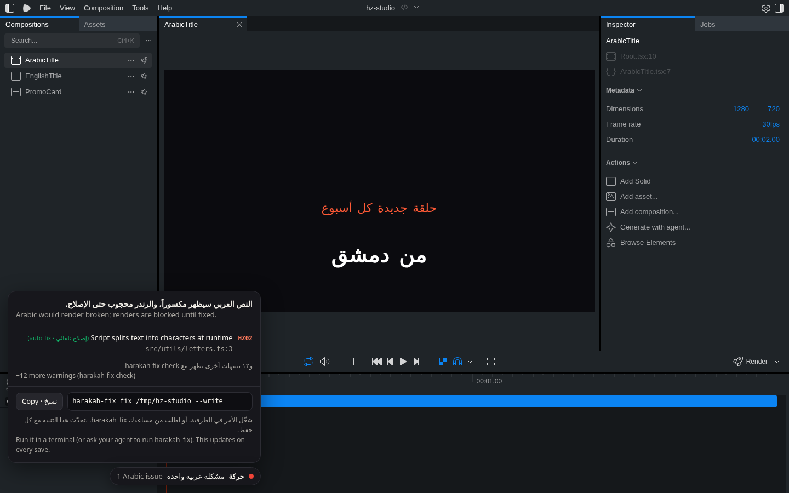

# Harakah inside Remotion (`remotion.config.ts`)

This makes Remotion itself refuse to render broken Arabic. It works with or without an agent, an npm script or CI.

```ts
// remotion.config.ts
import { Config } from "@remotion/cli/config";
import { withHarakah } from "harakah-fixer/remotion";

Config.overrideWebpackConfig(withHarakah());
// with an existing override: Config.overrideWebpackConfig(withHarakah(myOverride, { strict: true }))
```

| Where | Behaviour |
|---|---|
| `remotion render` / `remotion still` / `bundle()` / Lambda deploys | Bundling **fails** while the gate fails. The error lists each problem (`file:line code title`) and the fix command. |
| `remotion studio` (watch mode) | A yellow warning in the terminal after each relevant save (`.tsx`, `.jsx`, `.css`). It never blocks or delays hot reload. |

Options are `{ strict, assumeArabic, root, mode: "auto" | "warn", studioOverlay, inputProps, composition, argv, cli, nodeArgs, timeoutMs, verbose, layout }`.

`layout: true` (or `HARAKAH_LAYOUT=1`) also runs the runtime layout audit (HZ24). The gate bundles your compositions, seeks sampled frames in headless Chrome, and fails when Arabic letters, words or rows land in the wrong visual order. It adds a few seconds per composition, so it's opt-in; the timeout rises to 300 s. `HARAKAH_LAYOUT=0` turns it off. The same audit runs on demand with `harakah-fix audit . [--composition Title]`.

### Inside Remotion Studio · داخل الاستوديو

In `remotion studio`, a small **حركة** pill sits in the bottom-left corner. While Arabic would render broken it opens a panel listing each problem (rule, file:line, auto-fixable or not), the warning count, and the fix command with a copy button. After every relevant save (components, CSS, `theme.ts`/`styles.ts`), Harakah re-checks in the background and the panel updates live through hot reload, about 2 s after a fix. When everything is fine it turns green and collapses by itself.



**Layout over time (HZ24).** With `withHarakah({ layout: true })` (or `HARAKAH_LAYOUT=1`), the panel has a second section, **ترتيب العرض عبر الإطارات · Layout over time**. It lists the runtime findings per composition. The composition open in Studio comes first and is outlined. Each finding shows the text, what went wrong, the flagged frame numbers (Studio frames, so you can scrub straight to them) and the suggested fix. For letters or words in normal flow that is "add `dir="rtl"` to the `<div>` holding the text", marked ✓ when Harakah re-rendered those frames with the fix in Chrome and the problem was gone. For absolutely placed letters it is "place item i at the mirrored slot". These findings are not repeated in the main list. With layout off, the section is a one-line hint on how to turn it on. The data comes from `harakah-fix gate --layout --json` (`layout: [{ file: "<root>/#CompositionId", issues: [{ frames, suggest, … }] }]`).

The panel is added to development builds only. Render bundles (`remotion render`, `still`, Lambda, renders queued from Studio) never contain it, and it hides itself in headless renders and the Player. It's plain DOM in a shadow root, so it doesn't touch your styles. Results live in the OS temp dir (`harakah-studio/<hash>/results.json`), outside your project. Turn it off with `withHarakah({ studioOverlay: false })`. `HARAKAH_GATE=off` disables everything.

### Render-time props · خصائص وقت الرندر

Arabic that only arrives with `--props` is checked too. `npx remotion render LowerThird out.mp4 --props props.ar.json` works with no extra config: the plugin reads `--props` and the composition id from the Remotion command itself. A component whose `defaultProps` are English, and that looks fine in Studio, is still blocked when the Arabic props would break it. To pin props yourself, use `withHarakah({ inputProps: { name: "ريم" } })` or `withHarakah({ inputProps: "props.ar.json", composition: "LowerThird" })`. `argv: false` turns off reading the command line.

The CLI flag is the same: `harakah-fix check|fix|gate|compare <project> --props props.ar.json [--composition LowerThird]`. MCP tools take `props` and `composition`, and the Claude Code pre-render hook reads `--props` from the render command it is about to allow. The environment variable `HARAKAH_GATE` can be `off`, `warn`, `strict` or `lenient`. A gate that couldn't run (or couldn't finish the layout audit) blocks the render with the reason; `lenient` renders anyway, `warn` never blocks.

The module is a dependency-free CommonJS file. The check runs `harakah-fix gate --json` as a child process, so ts-morph never loads into Remotion's config or bundler process. It works with the webpack bundler and should work with Remotion's experimental rspack bundler, which has the same plugin hooks (not tested).

It's tested end to end with the real `@remotion/bundler`: the broken fixture project is rejected and a clean project bundles (`test/remotion-config.test.ts`). It was also checked manually with `npx remotion still`, which exits 1 with the list.
